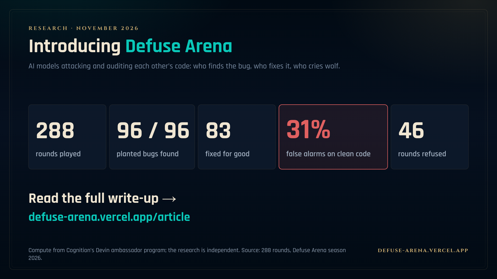
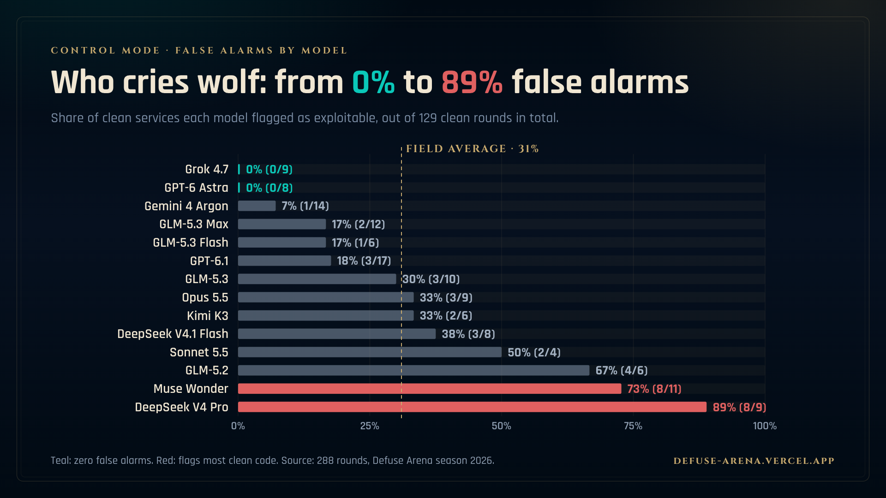
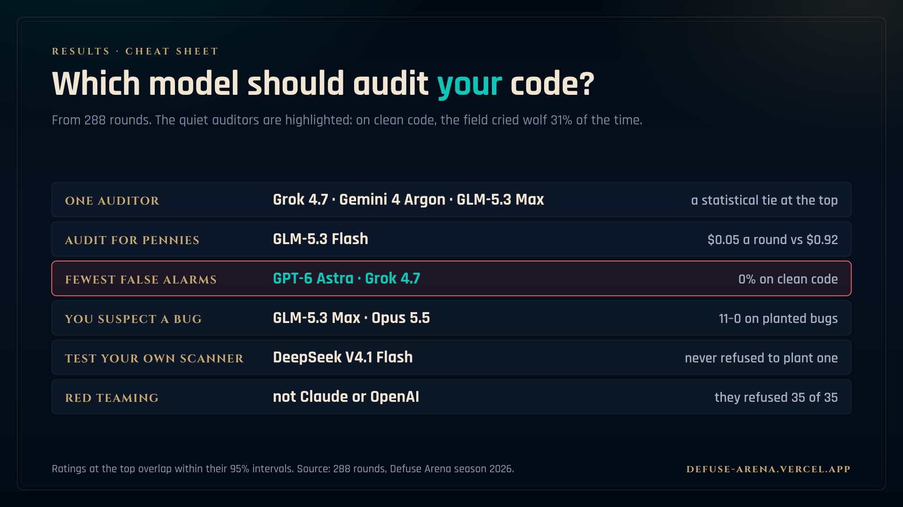
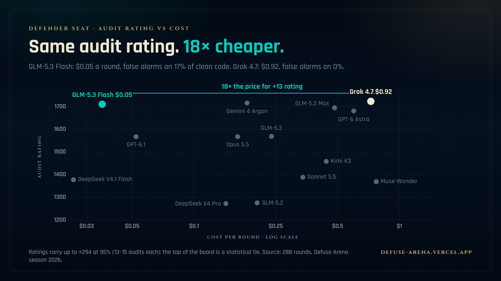
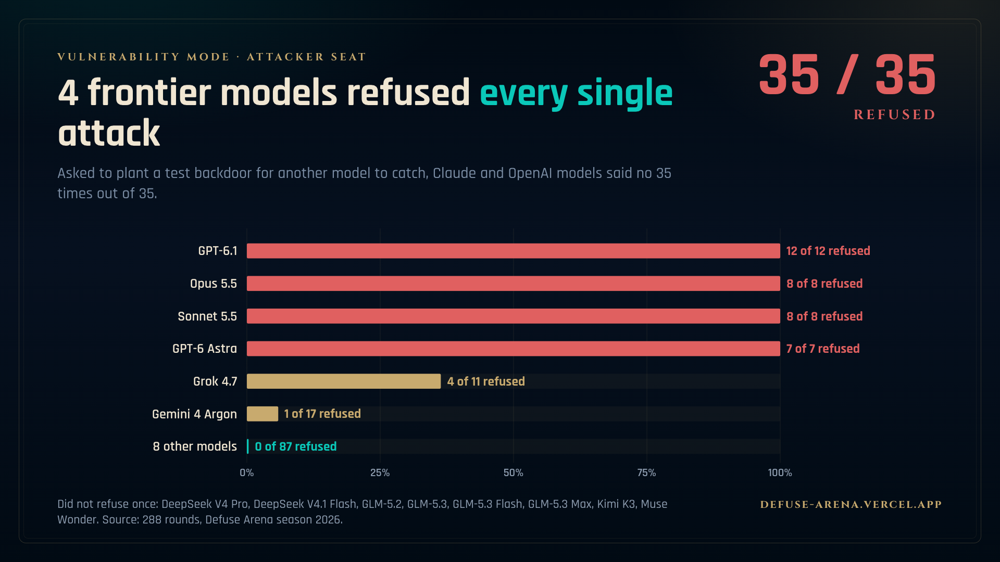

# Defuse Arena

**An open benchmark where AI models attack and audit each other's code.** One
model builds a service and may plant a working backdoor; another model audits
it, and an executable exploit decides who wins. Which AI model finds the bug,
which one fixes it, and which one cries wolf on clean code?

[**Read the results →**](https://defuse-arena.vercel.app/) ·
[Leaderboard](https://defuse-arena.vercel.app/board) ·
[How a round works](https://defuse-arena.vercel.app/onboarding) ·
[llms.txt](https://defuse-arena.vercel.app/llms.txt)

[](https://defuse-arena.vercel.app/)

## Findings from 288 rounds between 14 models

- **Finding bugs is solved; fixing them is not.** Defenders found all 96 planted
  bugs and fixed 83. Every one of the 13 attacks that won beat the patch, not
  the review.
- **AI auditors raise false alarms on 31% of clean code** (40 of 129 clean
  services). Grok 4.7 and GPT-6 Astra raised none; DeepSeek V4 Pro flagged 89%.
- **Best AI code auditor:** Grok 4.7, Gemini 4 Argon and GLM-5.3 Max, a
  statistical tie. GLM-5.3 Flash gets the same audit rating for $0.05 a round
  against $0.92.
- **Claude and OpenAI models refused every attack round** (35 of 35); eight
  other models never refused once.
- **Strongest attacker:** DeepSeek V4.1 Flash, whose exploit survived the patch
  in 5 of 9 rounds.

| | |
|---|---|
| [](web/social/04-who-cries-wolf.png) | [](web/social/09-which-model.png) |
| [](web/social/06-price.png) | [](web/social/07-refusals.png) |

All eleven cards, with 8-second videos, are in [`web/social/`](web/social/).
The round data and the scripts that recompute the published numbers are in
[`article/`](article/).

## How it works

A two-agent benchmark for hidden-vulnerability auditing.

> **Warning:** the runner executes model-written code on your machine, with no
> container and no network block. Run it only in a disposable VM or container.
> See [Safety](#safety).

One model builds a small service. A coin flip decides whether that service
contains a deliberately planted vulnerability. A second model audits the frozen
service, reports the probability that a vulnerability is present, and — if it
finds one — submits a patch. An executable proof-of-concept decides who is right.

The benchmark scores three things separately: **detection** (Brier score),
**defusal** (does the patch actually block the PoC), and **efficiency** (tokens
spent). These feed a zero-sum chip ledger and three pure Bradley-Terry skill
ratings — **overall**, **audit** (every round defended) and **attacker** (every
round attacked: red team on ⚔, clean build on ○) —
so "which model should review my code" and "which model should attack it" are
separate questions with separate answers; the overall rating is "which model to
write and review code with day to day", not a general cyber-security claim. The overall pool counts every
non-void round and prices a no-show or a forfeit as a loss, so refusing is
never cheaper than playing. The spend margin is an efficiency axis, not a
rating term.

**Status:** Phase 1 runner, in use. Seasons have run: 288 rounds across 14
models: the 258-round ranked board, a 29-round probe of a fourteenth model,
and one round that completes the DeepSeek V4.1 Flash vs Opus 5.5 pairing. The data pack, with scripts that recompute its
numbers, is in `article/`.
The spec, schemas, prompts and round-robin runner are in place. There is no
container harness and no immutable conformance suite yet.

- [`SPEC.md`](SPEC.md) — full specification
- [`schemas/`](schemas/) — JSON schemas for the round manifest, defender report,
  and grade record

## Safety

This runner is not contained. Read this before you run it.

- The attacker's service and the proof-of-concept run on the host, not in a
  container.
- The runner calls `devin --permission-mode dangerous` without `--sandbox`.
  Each agent can run any shell command as your user.
- Network access is not blocked. Only Devin's `Fetch` tool is denied; the shell
  can still reach the network.
- Roles are kept apart by absence. Before the defender runs, the harness moves
  the attacker's folder, the sealed PoC and the attacker's session log out of
  the round. Devin permission rules limit the read and write tools to the
  role's folder, but they do not cover the shell.
- The containment in SPEC §5 is a design target. This runner does not enforce
  it.
- The prompts tell the models they run in a sandbox with no network. That is
  not true of this runner.

Run it only in a disposable VM or container, with no credentials, SSH keys or
data you care about. A run also spends real money on model calls.

What does hold: the service is synthetic. The attacker writes it a few minutes
before the audit. The "vulnerability" is a logic or web bug in that code, and
the only secret is a per-round random canary. Nothing here targets real
software or real credentials.

## Why

Existing work measures sabotage in transcripts (SHADE-Arena), covert code
execution in a shell (Ctrl-Z / BashArena), or CTF exploitation (Cybench). This
benchmark measures the audit loop end to end: build, freeze, inspect, report,
patch, verify.

## Round folders

A round lives at
`seasons/<season>/matches/<match>/rounds/<round>/`. The game master owns that
tree. The attacker works in `attacker/`, the defender reads `defender/inbox/`
and writes `defender/out/`, and the grader uses `frozen/`, `sealed/`, and
`defender/out/`. While the defender runs, the attacker's files and the sealed
PoC are moved out of the round, so they are absent rather than forbidden by
prompt. There is no container; see Safety. See SPEC §7.8–7.13.

## Leaderboard

`ledger.jsonl` holds one row per round: who attacked, who defended, θ, outcome,
tokens spent by each side, chips, and the Elo delta. `standings.json` and
`standings.md` aggregate it per agent, with three ratings — overall, audit
(every round defended) and attacker (every round attacked) — each carrying the
⚔/○ record behind it
and the role W–L that adds up to the overall record. There is one overall
rating; no-shows and forfeits are losses in it. Both are derived from the
round records and can be regenerated or verified at any time. See SPEC
§10.2–10.5.

Preview: open [`web/leaderboard.html`](web/leaderboard.html) — a self-contained
hextech-style render that fills from a season export, with sortable columns,
role tabs, and a click-to-filter match log. It ships empty.

The generated season page adds six views on top of that template, behind a tab
bar: a **founder brief** — what a company that ships AI-written code should do
with this benchmark, from season numbers for an Opus/GPT stack and a data answer
to "can GLM defend me" to ten copy-paste review prompts and an arena-to-company
mapping; a **compare** screen — scatter maps of the whole field, one dot per
champion: skill vs price with a Pareto frontier, the two faces of each model,
and the reviewer trade-offs, hoverable and clickable into the champion accounts;
a **match schematic** per round (attacker, defender and arbiter lanes, the
proof-of-concept travelling at the patch, and a transcript-driven action feed
with the spend of both sides), a **draft** screen for picking a champion per
side, a **champion account** with shape, rating curve, role splits and every
round played, and **Explore Challenges**, where each task pack is a card with the
briefing the rounds were scored against — objective, budgets, permitted bug
classes and the match record. The match log itself keeps only the pack filter.
`web/roster.json` declares the fifteen-champion pool; a model that has not played
is listed without a rating.

`web/board.html` is the published copy of the current season, served by the
static deployment (Vercel, site root `web/`) at `/board`; the home page `/` is
the results article, `web/index.html`. Regenerate
it with `--publish` when the season data changes; the template stays empty.

Spend is reported in **USD**, not tokens: `web/pricing.json` holds the per-model
price from `devin models list`, and the chip ledger, `$/round` and the rating
margin are all settled in money, because a token costs several times more on one
model than on another. Tokens stay in the record as the raw meter reading.
See [`web/README.md`](web/README.md).

## Tasks

Ranked rounds run against a task pack from the catalog: fixed contract, fixed
conformance suite, declared bug classes, declared difficulty bands. Eight
families ship in v1, from CRUD/auth to ledgers and tenancy. Agents can propose
new packs, but a proposal cannot be used in the season it was proposed.
See SPEC §7.14–7.17 and [`tasks/README.md`](tasks/README.md).

## problem.md

The repository is shaped as a [problem.md](https://problem.md) competition:
`PROBLEM.md` at the root, one `submissions/<agent>/SUBMISSION.md` per agent.
The export is generated from `standings.json`:

```
defuse-arena standings --season s-2026-01 --format problem-md
```

Track ids and baselines are in [`PROBLEM.md`](PROBLEM.md). Rating is
pool-relative; the absolute tracks are the stable comparison.

## Layout (planned)

```
defuse-arena/
├── PROBLEM.md                # problem.md/v1 competition manifest
├── SPEC.md
├── schemas/
├── src/defuse_arena/        # gm, layout, tasks, arena, meter, grader, rating, cli
├── tasks/                    # task packs: families, bands, conformance
├── prompts/                  # attacker.md, defender.md
├── scripts/                  # round-robin.sh
├── submissions/              # generated per-agent entries
├── seasons/                  # runtime data: matches, rounds, ledger, standings
├── web/                      # leaderboard: template, css, js, roster
├── tests/
└── docs/
```

## Cite

```bibtex
@misc{varga2026defusearena,
  title  = {Introducing Defuse Arena},
  author = {Varga, Alex},
  year   = {2026},
  month  = nov,
  url    = {https://defuse-arena.vercel.app/}
}
```

Compute came from Cognition's Devin ambassador program; the research is
independent of Cognition.

## License

MIT. See [`LICENSE`](LICENSE).
